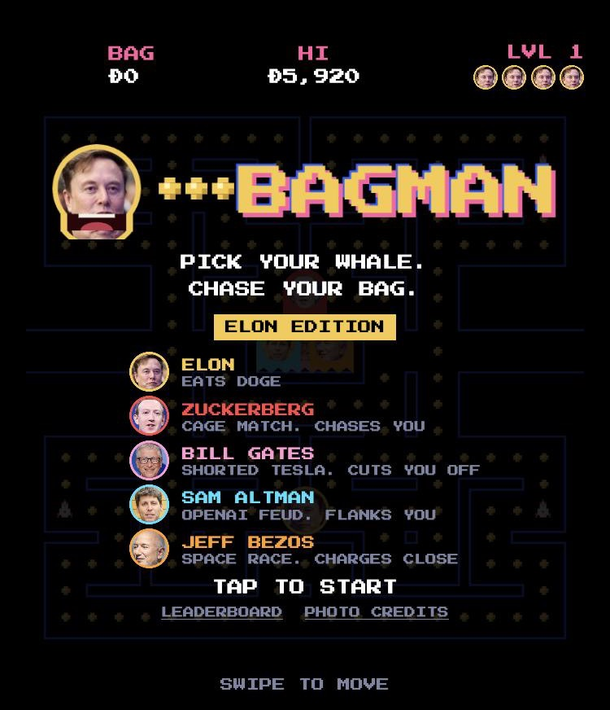
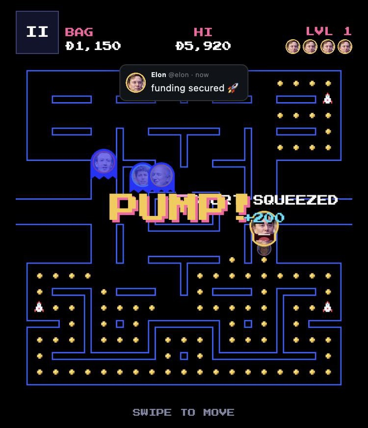
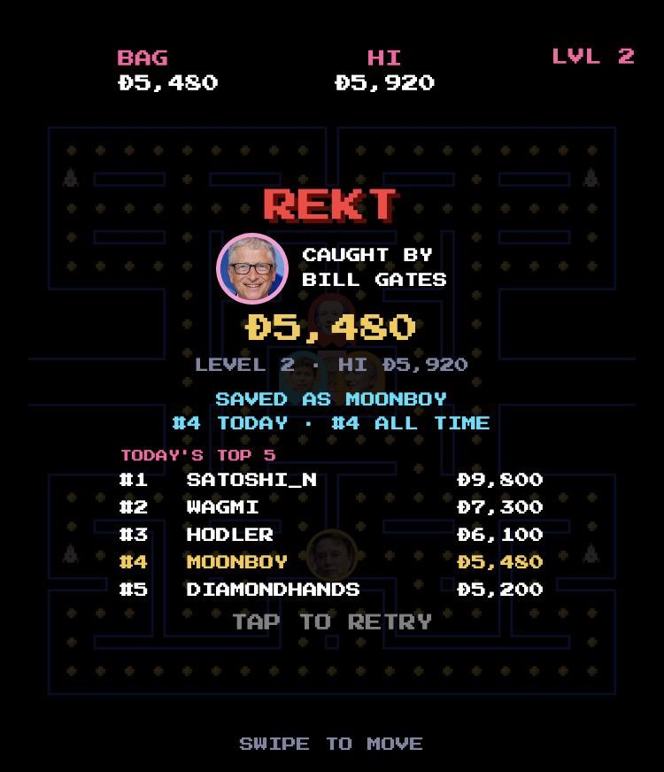
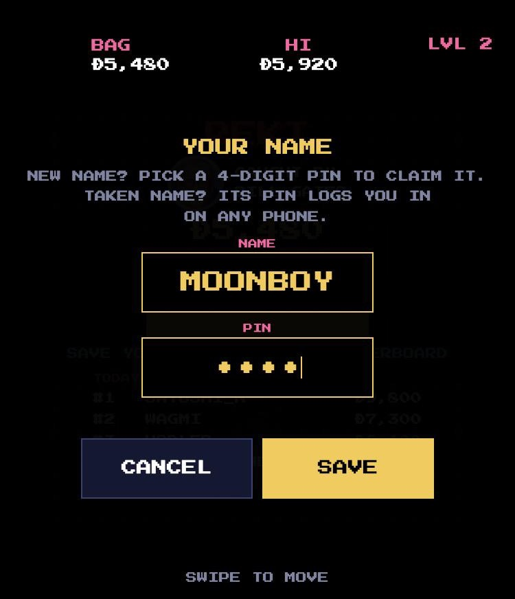

<p align="center"></p>

<p align="center"><b>Elon eats Doge. Zuckerberg, Gates, Altman and Bezos chase him.</b><br>
A free, mobile-first Pac-Man parody that runs in the browser.</p>

<p align="center">
  
  
  
  
</p>
<p align="center">
  
  
  
</p>

## The game

- **Elon** chomps Doge coins with a puppet jaw. Swipe to move (arrow keys or WASD on desktop).
- **Four rivals** chase him, each in their own way: Zuckerberg hunts you, Gates cuts you off, Altman flanks you and Bezos charges when he gets close.
- **The Tweet** 🚀 power-up: Elon posts, Doge pumps and the rivals turn blue so you can eat them.
- **Clear a level** and Elon rides a rocket to the moon. Each level gets a little faster.
- **Pause, save & quit, continue.** Runs are saved automatically, including when the phone locks.
- **Leaderboard** with today's and all-time top 10. Players claim a name with a 4-digit PIN, and the same name + PIN logs them in on any phone.
- **Installable:** "Add to Home Screen" opens it full screen with its own icon.

## Run locally

```bash
npm install
npm run dev
```

Then open http://localhost:8642. The local leaderboard lives in `.wrangler/` and is separate from the live one.

## First deploy

1. Log in to Cloudflare (opens a browser window to approve):
   ```bash
   npx wrangler login
   ```
2. Create the database, then paste the `database_id` it prints into `wrangler.jsonc`:
   ```bash
   npx wrangler d1 create bagman
   ```
3. Create the tables on the live database:
   ```bash
   npm run db:remote
   ```
4. Deploy. This prints the live `*.workers.dev` link:
   ```bash
   npm run deploy
   ```
5. Set the two secrets right away, before sharing the link (each command asks for a value, so use long random strings):
   ```bash
   npx wrangler secret put SALT
   npx wrangler secret put ADMIN_KEY
   ```
   Never change `SALT` after launch: PINs are checked with it, so every saved name would stop working.

After that, `npm run deploy` publishes any change.

## Moderation

Remove a cheater from the leaderboard (their name stays reserved):

```bash
curl -X POST https://YOUR-LINK/api/admin/delete -H "X-Admin-Key: YOUR_ADMIN_KEY" -H "Content-Type: application/json" -d '{"name":"CHEATER"}'
```

Add `"release": true` to also free the name, for example when a player forgot their PIN and wants to claim it again.

The server rejects scores that are impossible for the level and play time, allows 30 scores and 20 login attempts per hour per IP, locks a name for 15 minutes after 5 wrong PINs and filters offensive names. A determined cheater can still fake a score from the browser, so check the top of the board now and then.

## Credits

Photo credits and licenses: `public/faces/CREDITS.md` (also shown in the game). BAGMAN is a parody and is not affiliated with or endorsed by anyone pictured.
